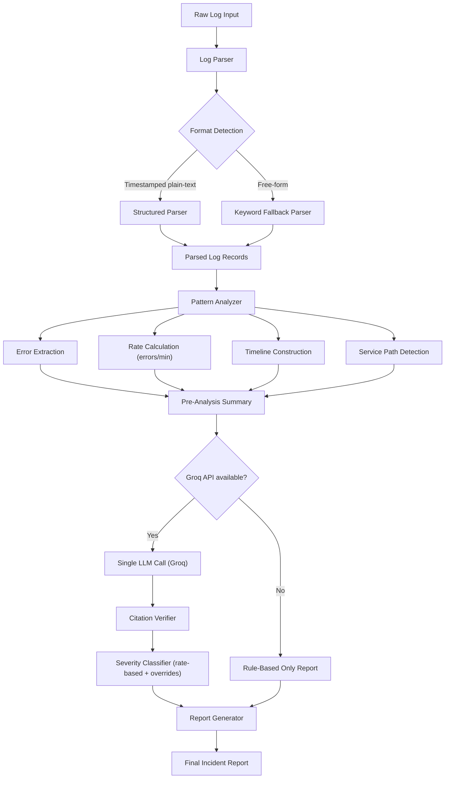

# 🚀 AI-Powered Incident Analyzer — Project Plan

> **Project:** Pine Labs Technology Operations — Practical AI Assignment 1  
> **Goal:** Build a tool that accepts application logs, identifies errors/patterns, classifies severity, suggests root causes, and generates an incident summary for support engineers.  
> **Date:** 2026-11-18  
> **AI Provider:** Groq API (with rule-based fallback when API is unavailable)

---

## Table of Contents

1. [High-Level Architecture](#1-high-level-architecture)
2. [Technology Stack](#2-technology-stack)
3. [Project Structure](#3-project-structure)
4. [Feature Breakdown](#4-feature-breakdown)
5. [Sample / Simulated Log Data Strategy](#5-sample--simulated-log-data-strategy)
6. [AI / LLM Integration Design](#6-ai--llm-integration-design)
7. [Hallucination Prevention — Citation Verification](#7-hallucination-prevention--citation-verification)
8. [UI / UX Design](#8-ui--ux-design)
9. [Incident Analysis Pipeline (Core Logic)](#9-incident-analysis-pipeline-core-logic)
10. [Severity Classification Logic](#10-severity-classification-logic)
11. [Recommendation Ordering & Safety](#11-recommendation-ordering--safety)
12. [Output / Report Format](#12-output--report-format)
13. [Testing Strategy](#13-testing-strategy)
14. [Deliverables Checklist](#14-deliverables-checklist)
15. [Implementation Phases & Timeline](#15-implementation-phases--timeline)
16. [Risk Analysis & Mitigations](#16-risk-analysis--mitigations)
17. [Presentation & Q&A Prep](#17-presentation--qa-prep)

---

## 1. High-Level Architecture

```
┌──────────────────────────────────────────────────────────┐
│                      Frontend (Streamlit)                │
│  ┌────────────┐  ┌──────────────┐  ┌──────────────────┐ │
│  │ Log Upload  │  │  Copy-Paste  │  │  Sample Logs     │ │
│  │ (.log/.txt) │  │  Text Area   │  │  Quick-Load      │ │
│  └─────┬──────┘  └──────┬───────┘  └────────┬─────────┘ │
│        └────────────┬────┘───────────────────┘           │
│                     ▼                                    │
│          ┌──────────────────────┐                        │
│          │   Log Preprocessor   │  (cleaning, parsing)   │
│          └──────────┬───────────┘                        │
│                     ▼                                    │
│          ┌──────────────────────┐                        │
│          │  Rule-Based Analyzer │  (regex patterns,      │
│          │  (First Pass)        │   rate calculation)     │
│          └──────────┬───────────┘                        │
│                     ▼                                    │
│          ┌──────────────────────┐                        │
│          │  Groq LLM Analyzer   │  (single structured    │
│          │  (Deep Analysis)     │   call: root cause +   │
│          │                      │   severity + summary)  │
│          └──────────┬───────────┘                        │
│                     ▼                                    │
│          ┌──────────────────────┐                        │
│          │  Citation Verifier   │  (checks AI claims     │
│          │                      │   against actual logs)  │
│          └──────────┬───────────┘                        │
│                     ▼                                    │
│  ┌─────────────────────────────────────────────────────┐ │
│  │             Interactive Results Dashboard           │ │
│  │  • Error Summary   • Severity Badge                 │ │
│  │  • Root Cause      • Diagnostic Checks              │ │
│  │  • Timeline View   • Downloadable Report (.md)      │ │
│  └─────────────────────────────────────────────────────┘ │
└──────────────────────────────────────────────────────────┘
```

**Why this architecture?**
- **Two-pass analysis** (rule-based + AI) ensures the AI gets structured context, not raw noise, producing better results.
- **Streamlit** gives us a polished UI with minimal frontend effort — perfect for a prototype.
- The rule-based layer works **even if the Groq API is down**, providing graceful degradation.
- **Citation verifier** sits between the AI output and the report to catch hallucinated claims.

---

## 2. Technology Stack

| Layer | Technology | Rationale |
|-------|-----------|-----------|
| **Language** | Python 3.11+ | Best ecosystem for AI/ML, rapid prototyping |
| **Frontend** | Streamlit | Zero JS needed, built-in file upload, `st.bar_chart`, markdown rendering |
| **AI Model** | Groq API (`openai/gpt-oss-20b` by default) | Fast inference, JSON mode, OpenAI-compatible SDK; model ID is configurable |
| **Log Parsing** | Python `re` (regex) + custom parser | Handles the two supported log formats well |
| **Data Handling** | Pandas | For tabulating errors, rate calculations, timeline analysis |
| **Visualization** | `st.bar_chart` / Streamlit native charts | Error frequency over time, severity distribution |
| **Export** | Markdown download + copy-to-clipboard | Shareable incident reports |
| **Environment** | `venv` + `requirements.txt` | Simple, no Docker needed for prototype |

---

## 3. Project Structure

```
Pine Labs AI Incident analyzer/
├── app.py                      # Streamlit main entry point
├── requirements.txt            # Python dependencies
├── .env.example                # Template for GROQ_API_KEY
├── README.md                   # Setup, approach, assumptions, testing, limitations,
│                               #   expected-vs-actual severity table,
│                               #   "where I used AI tools" log
├── Case Study.md               # Original assignment
├── PLAN.md                     # This plan
│
├── src/
│   ├── __init__.py
│   ├── log_parser.py           # Log ingestion, cleaning, structuring
│   ├── pattern_analyzer.py     # Rule-based error detection (regex, rates)
│   ├── ai_analyzer.py          # Groq API — single structured call
│   ├── citation_verifier.py    # Validates AI "confirmed" claims against log lines
│   ├── severity_classifier.py  # Rate-based scoring + override rules
│   ├── report_generator.py     # Incident summary + recommendations
│   └── utils.py                # Helpers (timestamp parsing, dedup, etc.)
│
├── prompts/
│   └── analysis_prompt.py      # Single system + user prompt template
│                               #   (root cause + severity + summary in one call)
│
├── sample_logs/
│   ├── payment_api_timeout.log       # Scenario 1: Payment API timeouts + cascading
│   ├── database_connection.log       # Scenario 2: DB connection failures
│   ├── auth_service_failure.log      # Scenario 3: Authentication issues
│   ├── post_deploy_spike.log         # Scenario 4: Error spike after deployment
│   ├── ambiguous_thin.log            # Scenario 5: Too few errors to diagnose
│   ├── mixed_incident.log            # Scenario 6: Multiple unrelated issues
│   └── healthy_system.log            # Scenario 7: Normal operation (no errors)
│
├── tests/
│   ├── test_log_parser.py
│   ├── test_pattern_analyzer.py
│   ├── test_severity_classifier.py
│   ├── test_citation_verifier.py
│   └── test_sample_scenarios.py
│
└── docs/
    ├── presentation_outline.md  # 10-min presentation structure
    └── screenshots/             # UI screenshots for presentation
```

---

## 4. Feature Breakdown

### Feature 1: Log Input (Upload or Copy-Paste)
- **File upload:** `.log`, `.txt` files (single file)
- **Copy-paste:** Large text area
- **Quick-load:** Buttons to load any of the 7 sample log scenarios
- **Input validation:** Reject empty input, files > 2MB, non-text files

### Feature 2: Log Parsing
- **Supported format: Timestamped plain-text logs** — the standard format used in the sample scenarios:
  ```
  2026-11-18 10:15:32 ERROR ServiceName - Message text here
  ```
- **Fallback: free-form lines** — if no timestamp/level is detected, treat each line as a raw message and extract what we can via keyword matching
- Both formats are clearly documented in the README

### Feature 3: Error Pattern Detection (Rule-Based)
- Regex-based extraction of:
  - **Timestamps** (ISO 8601-style: `YYYY-MM-DD HH:MM:SS`)
  - **Log levels** (ERROR, WARN, FATAL, CRITICAL, INFO, DEBUG)
  - **HTTP status codes** (4xx, 5xx)
  - **Known error patterns** (timeout, connection refused, OOM, null pointer, stack traces)
  - **Service names, request IDs** for correlation
- **Rate calculation:** errors per minute, computed from the actual time window of the logs
- Timeline construction: when did errors start, peak, and stop?

### Feature 4: AI-Powered Root Cause Analysis (Single LLM Call)
- Send structured (pre-parsed) log data to Groq in **one call** that returns:
  - Root cause analysis with confidence tags
  - Severity assessment
  - Incident summary
  - Diagnostic checks and recommendations
- Prompt engineering to ensure the AI:
  - **Separates evidence from assumptions** (key requirement!)
  - **Cites specific log line numbers or quoted snippets** for every "confirmed" finding
  - Identifies causal chains (e.g., DB failure → API timeout → user errors)
  - Can output `"insufficient_evidence": true` when logs are too thin to diagnose
- Output: structured JSON for downstream rendering and verification

### Feature 5: Citation Verification (Anti-Hallucination)
- Every AI finding tagged `"confirmed"` must include a `line_ref` (line number or quoted snippet)
- Code checks that the referenced line/snippet **actually exists** in the parsed logs
- Findings that fail verification are **downgraded** from "confirmed" to "unverified" with a ⚠️ flag
- This is the concrete, testable answer to "how do you stop hallucinations?"

### Feature 6: Severity Classification
- **Four levels:** Critical / High / Medium / Low
- **Rate-based** scoring, not raw counts (see [Section 10](#10-severity-classification-logic))
- **Override rules** for critical service paths (payment, auth)
- Clear explanation of *why* the severity was assigned

### Feature 7: Recommendation Ordering & Safety
- Output structured as: **read-only diagnostic checks → hypothesis tested → escalation**
- Destructive or risky actions (restarts, config changes) are **labelled** as "for the owning team to decide"
- Never present a guess as a confirmed action (see [Section 11](#11-recommendation-ordering--safety))

### Feature 8: Incident Summary Report
- **One-pager** format suitable for sharing with ops/engineering teams
- Sections: Summary, Timeline, Root Cause, Impact, Diagnostic Checks, Escalation
- Downloadable as `.md` file
- Copy-to-clipboard button for quick Slack/email sharing

---

## 5. Sample / Simulated Log Data Strategy

> [!IMPORTANT]
> The case study says "Use sample or simulated data only." All logs are realistic but entirely fabricated.

### Scenario 1: Payment API Timeouts + Cascading Failures
```
2026-11-18 10:15:32 ERROR PaymentService - API request to /v2/payments/process timed out after 30000ms
2026-11-18 10:15:33 WARN  ConnectionPool - Active connections: 48/50, waiting: 12
2026-11-18 10:15:34 ERROR DatabaseService - Connection to payment_db failed: Too many connections
...
```
- Pattern: DB connection pool exhaustion → API timeouts → cascading failures
- ~100 log lines, errors concentrated in a 15-minute window
- **Expected severity: Critical** (payment path affected + cascading failures)

### Scenario 2: Database Connection Failures
- Intermittent connection drops, slow queries, deadlocks
- Errors on a non-payment service, spread over 30 minutes
- **Expected severity: High**

### Scenario 3: Authentication Service Failures
- Token validation failures, expired certificates, rate limiting
- Sustained errors on the auth path
- **Expected severity: High** (auth path override applies)

### Scenario 4: Post-Deploy Error Spike *(new)*
- A deployment at 14:00, followed by a burst of `NullPointerException` and `ClassNotFoundException` errors from one service
- Error spike is sharp (high rate) but limited to a single non-critical service
- Errors stop after a rollback at 14:12
- **Expected severity: Medium** (high rate but non-critical path, self-resolved)

### Scenario 5: Ambiguous / Too-Thin Logs *(new)*
- Only 8–10 log lines total
- 2–3 WARN-level entries, no ERRORs, no clear pattern
- Could be a startup hiccup, a log rotation boundary, or the beginning of something bigger
- **Expected output: "Insufficient evidence to determine root cause."**
- **Expected severity: Low** with explicit "insufficient data" flag

### Scenario 6: Mixed Incident
- Multiple unrelated issues happening concurrently (disk warnings + a timeout + an auth blip)
- Tests the tool's ability to separate distinct failure threads
- **Expected severity: Medium**

### Scenario 7: Healthy System (Negative Test)
- Only INFO/DEBUG logs, no errors, no warnings
- Tool should report "No significant issues detected"
- **Expected severity: None / No issues** (score = 0)

Each scenario will have **50–200 log lines** (except Scenario 5 which is intentionally thin at ~10 lines).

---

## 6. AI / LLM Integration Design

### Single Structured Call

One prompt, one API call. This is easier to test, easier to explain in Q&A, and cheaper on tokens.

```
┌────────────────────────────────────────────────┐
│              SYSTEM PROMPT                     │
│  You are an expert SRE / incident analyst.     │
│  - Analyze the structured log summary below    │
│  - ALWAYS separate evidence from assumptions   │
│  - For every "confirmed" finding, cite the     │
│    log line number or a short quoted snippet    │
│  - If the logs are too thin or ambiguous to     │
│    diagnose, say so explicitly                  │
│  - Recommendations must be ordered:            │
│    read-only checks first, then hypothesis,     │
│    then escalation. Label restarts/config       │
│    changes as "for the owning team to decide"  │
│  - Respond in the JSON schema provided         │
└────────────────────────────────────────────────┘
                    +
┌────────────────────────────────────────────────┐
│              USER PROMPT                       │
│  Pre-parsed data:                              │
│  - Error summary table (from rule-based pass)  │
│  - Error rate (errors/min) and time window     │
│  - Timeline of events                          │
│  - Numbered raw log lines (error/warn only)    │
│                                                │
│  Return JSON with:                             │
│  - root_cause_analysis (with confidence tags   │
│    and line_ref citations)                     │
│  - severity (Critical/High/Medium/Low + reason)│
│  - incident_summary (1–2 paragraph narrative)  │
│  - diagnostic_checks (ordered list)            │
│  - escalation (when and to whom)               │
│  - insufficient_evidence (boolean)             │
└────────────────────────────────────────────────┘
```

### JSON Response Schema (what the LLM must return)

```json
{
  "root_cause_analysis": {
    "findings": [
      {
        "description": "Database connection pool reached capacity",
        "confidence": "confirmed",
        "line_ref": "L42: 'Active connections: 48/50, waiting: 12'"
      },
      {
        "description": "Possible connection leak from recent deployment",
        "confidence": "possible",
        "line_ref": null
      }
    ]
  },
  "severity": {
    "level": "Critical",
    "reasoning": "Payment path is affected with sustained error rate of 12/min over 15 minutes, and failures are cascading to downstream services."
  },
  "incident_summary": "...",
  "diagnostic_checks": [
    {
      "action": "Check current DB connection pool utilization",
      "type": "read_only",
      "tests_hypothesis": "Connection pool exhaustion is the bottleneck"
    },
    {
      "action": "Query pg_stat_activity for long-running transactions",
      "type": "read_only",
      "tests_hypothesis": "Leaked connections are holding the pool open"
    },
    {
      "action": "Restart payment service to reset connection pool",
      "type": "owning_team_decision",
      "tests_hypothesis": "Stale connections can be cleared by restart"
    }
  ],
  "escalation": {
    "should_escalate": true,
    "to": "Database team, Payment platform team",
    "reason": "Payment processing is degraded with cascading downstream impact"
  },
  "insufficient_evidence": false
}
```

### Key Design Decisions

1. **Pre-process before sending to AI:** Don't dump raw logs into the LLM. Parse first, send structured summaries + numbered error lines. This:
   - Reduces token usage (cost)
   - Improves accuracy (less noise)
   - Gives the AI line numbers to cite

2. **Structured JSON output:** Force the LLM to respond in a defined schema so we can reliably render it in the UI and run citation verification.

3. **Evidence vs. Assumptions tagging:** The prompt explicitly requires the AI to tag each finding as:
   - `"confidence": "confirmed"` — directly observed in logs, **must include `line_ref`**
   - `"confidence": "likely"` — inferred from patterns, may include `line_ref`
   - `"confidence": "possible"` — speculative, needs verification

4. **"Insufficient evidence" escape hatch:** The AI can (and should) output `"insufficient_evidence": true` when the logs are too thin, ambiguous, or lack enough error signal to diagnose a root cause. This prevents the tool from guessing when it shouldn't.

5. **Fallback handling:** If the Groq API is unreachable, fall back to rule-based analysis only and display a banner saying "AI analysis unavailable — showing rule-based results only."

### API Configuration
```python
# .env
GROQ_API_KEY=your_key_here
GROQ_MODEL=openai/gpt-oss-20b
```

---

## 7. Hallucination Prevention — Citation Verification

> [!IMPORTANT]
> The assignment scores "does not present guesses as confirmed facts." This section is the concrete mechanism for that.

### How It Works

```
AI returns finding:
  description: "Database connection pool reached capacity"
  confidence: "confirmed"
  line_ref: "L42: 'Active connections: 48/50, waiting: 12'"

                    ▼

Citation Verifier checks:
  1. Does line 42 exist in the parsed log?
  2. Does line 42 contain the quoted text "Active connections: 48/50"?
  3. If YES → finding stays "confirmed" ✅
  4. If NO  → finding is downgraded to "unverified" ⚠️
             → a flag is shown in the report
```

### Implementation (`src/citation_verifier.py`)

```python
def verify_citations(findings: list[dict], log_lines: list[str]) -> list[dict]:
    """
    For each finding with confidence='confirmed':
    - Parse the line_ref to extract line number and/or quoted text
    - Check if the line exists and contains the quoted text
    - If verification fails, downgrade confidence to 'unverified'
    - Add a 'verified' boolean field to each finding
    """
    for finding in findings:
        if finding["confidence"] != "confirmed":
            finding["verified"] = None  # not applicable
            continue

        line_ref = finding.get("line_ref")
        if not line_ref:
            # "confirmed" with no citation → auto-downgrade
            finding["confidence"] = "unverified"
            finding["verified"] = False
            continue

        # Extract line number (e.g., "L42") and quoted text
        line_num = parse_line_number(line_ref)
        quoted_text = parse_quoted_text(line_ref)

        # Verify against actual log data
        if line_num and 0 < line_num <= len(log_lines):
            actual_line = log_lines[line_num - 1]
            if quoted_text and quoted_text.lower() in actual_line.lower():
                finding["verified"] = True  # ✅ confirmed + verified
            elif not quoted_text:
                finding["verified"] = True  # line exists, no quote to check
            else:
                finding["confidence"] = "unverified"
                finding["verified"] = False  # ⚠️ quote not found on that line
        else:
            finding["confidence"] = "unverified"
            finding["verified"] = False  # ⚠️ line doesn't exist

    return findings
```

### What This Gives You in Q&A

**Q: "How do you prevent AI hallucinations?"**

**A:** "Three layers. First, I pre-parse the logs and send numbered lines to the LLM so it has real data to work with. Second, the prompt requires every 'confirmed' finding to cite a specific log line number and quote. Third — and this is the key part — I have a `citation_verifier` module that programmatically checks whether the cited line actually exists in the log and whether the quoted text matches. If it doesn't, the finding is automatically downgraded from 'confirmed' to 'unverified' and flagged in the report. So even if the AI hallucinates a line reference, the user sees a warning, not a false fact."

---

## 8. UI / UX Design

### Page Layout (Single-Page App)

```
┌─────────────────────────────────────────────────┐
│  🔍 AI Incident Analyzer        [Pine Labs]     │
├─────────────────────────────────────────────────┤
│                                                 │
│  ┌─── Input Section ─────────────────────────┐  │
│  │  [Upload File] [Paste Logs] [Load Sample] │  │
│  │  ┌─────────────────────────────────────┐  │  │
│  │  │                                     │  │  │
│  │  │     (text area / file preview)      │  │  │
│  │  │                                     │  │  │
│  │  └─────────────────────────────────────┘  │  │
│  │           [🔍 Analyze Logs]               │  │
│  └───────────────────────────────────────────┘  │
│                                                 │
│  ┌─── Results Section ───────────────────────┐  │
│  │                                           │  │
│  │  ┌─ Severity ──┐  ┌─ Error Rate ───────┐ │  │
│  │  │  🔴 CRITICAL │  │  12 errors/min     │ │  │
│  │  │  (explained) │  │  over 15 min       │ │  │
│  │  └─────────────┘  └────────────────────┘ │  │
│  │                                           │  │
│  │  📋 Error Summary (expandable table)      │  │
│  │  📈 Error Timeline (st.bar_chart)         │  │
│  │  🔎 Root Cause Analysis                   │  │
│  │     ✅ Confirmed (with citations)         │  │
│  │     🔶 Likely (inferred)                  │  │
│  │     ❓ Possible (needs investigation)     │  │
│  │     ⚠️ Unverified (citation failed)       │  │
│  │  🛠️ Diagnostic Checks                     │  │
│  │     1. [read-only] Check pool util        │  │
│  │     2. [read-only] Query pg_stat          │  │
│  │     3. [team decision] Restart service    │  │
│  │  📄 Incident Summary (copy / download)    │  │
│  │                                           │  │
│  └───────────────────────────────────────────┘  │
└─────────────────────────────────────────────────┘
```

### UI Polish
- **Color-coded severity badges** (🔴 Critical, 🟠 High, 🟡 Medium, 🟢 Low)
- **Expandable/collapsible sections** for detailed analysis
- **Loading spinner** with status messages during AI analysis
- **Confidence badges** on each finding (✅ confirmed, 🔶 likely, ❓ possible, ⚠️ unverified)
- **Action type labels** on recommendations (🔍 read-only, ⚙️ team decision)

---

## 9. Incident Analysis Pipeline (Core Logic)



### Detailed Pipeline Steps

1. **Ingest:** Accept raw text or file → read contents as string
2. **Clean:** Strip ANSI colors, normalize line endings, remove empty lines
3. **Detect format:** Try timestamped plain-text regex → fallback to free-form keyword matching
4. **Parse:** Extract timestamp, level, source, message from each line; number each line
5. **Filter:** Separate ERROR/WARN/FATAL from INFO/DEBUG
6. **Analyze (rule-based):**
   - Count error types and **calculate rates** (errors per minute within the log's time window)
   - Detect known patterns (timeout, OOM, connection refused, etc.)
   - Build a timeline of events
   - Identify which **service paths** are affected (payment, auth, other)
   - Detect cascading patterns (errors in service A followed by errors in service B)
7. **Analyze (AI — single call):**
   - Send structured summary + numbered error/warn log lines to Groq
   - Parse JSON response
   - Run citation verifier on all "confirmed" findings
8. **Classify severity:** Rate-based scoring + service path override rules (see Section 10)
9. **Generate report:** Merge all findings into a structured incident summary

---

## 10. Severity Classification Logic

> [!IMPORTANT]
> This is rate-based, not count-based. 30 errors in 2 minutes is very different from 30 errors over a day. Healthy logs score exactly zero.

### Step 1: Rate-Based Scoring (0–100)

The base score is computed from the **error rate** (errors per minute) within the log's time window, the **log level mix**, and the **blast radius** (how many services are affected).

| Factor | Weight | Scoring |
|--------|--------|---------|
| **Error rate** | 35% | 0 errors/min = 0pts. >0–1/min = 8pts. >1–5/min = 15pts. >5–15/min = 25pts. >15/min = 35pts |
| **Highest log level** | 25% | FATAL/CRITICAL present = 25pts. ERROR only = 15pts. WARN only = 5pts. INFO/DEBUG only = 0pts |
| **Blast radius** | 25% | 3+ services with errors = 25pts. 2 services = 15pts. 1 service = 8pts. 0 services = 0pts |
| **Duration of error window** | 15% | >30 min sustained = 15pts. 10–30 min = 10pts. 2–10 min = 6pts. <2 min = 3pts. No errors = 0pts |

> **Note:** All factors score **0 when there are no errors**, so a healthy log produces a total score of 0.

### Step 2: Mapping to Severity

| Score | Severity |
|-------|----------|
| 0 | ✅ **None** — No significant issues detected |
| 1–24 | 🟢 **Low** — Minor warnings, no user impact, routine investigation |
| 25–49 | 🟡 **Medium** — Intermittent issues, limited impact, needs monitoring |
| 50–74 | 🟠 **High** — Major degradation, frequent errors, user impact likely |
| 75–100 | 🔴 **Critical** — Service outage, payment failures, data at risk |

### Step 3: Service Path Override Rules

These overrides **set a floor** — they can raise severity but never lower it.

| Condition | Floor |
|-----------|-------|
| Sustained errors (>2 min) on the **payment** path | **High** minimum |
| Sustained errors (>2 min) on the **auth** path | **High** minimum |
| **Payment** path down **+ cascading failures** (2+ services affected) | **Critical** minimum |

**Why overrides?** A payment outage with only 5 logged errors can't score Low just because the absolute count is small. If the payment path is broken for 3 minutes with 5 errors, the rate might be low but the business impact is Critical.

### Step 4: AI Adjustment

The LLM also returns a severity assessment. If it disagrees with the rule-based result:
- The rule-based severity is the **final answer** (deterministic, explainable).
- The AI's differing opinion is shown as a note: *"AI suggests [X] because [reason]"* — for the engineer's consideration.
- This prevents the AI from overriding the rubric, while still surfacing its contextual insights.

### Example Walkthrough

**Scenario: 5 payment errors over 3 minutes, with connection pool warnings**
- Error rate: 5/3 = 1.67 errors/min → 15pts (>1–5/min band)
- Highest level: ERROR → 15pts
- Blast radius: 2 services (PaymentService, DatabaseService) → 15pts
- Duration: 3 min → 6pts (2–10 min band)
- **Base score: 51 → High**
- Override check: payment path + sustained (>2 min) → floor = High ✅ (already at High)
- Override check: payment path + cascading (2 services) → floor = **Critical**
- **Final severity: 🔴 Critical**

This correctly flags a small-count but high-impact payment outage.

---

## 11. Recommendation Ordering & Safety

> [!WARNING]
> The assignment explicitly scores "does not present guesses as confirmed facts." Recommendations like "restart the service" or "increase pool size to 100" are **risky production actions** that are not proven by the logs alone. They must never be presented as confirmed steps.

### Output Order (Always)

```
1. READ-ONLY DIAGNOSTIC CHECKS (safe, information-gathering)
   → What to look at
   → What hypothesis each check tests

2. ESCALATION GUIDANCE
   → When to escalate, to whom, with what information

3. POTENTIAL REMEDIATION (labelled "for the owning team to decide")
   → Restarts, config changes, rollbacks
   → Always labelled as team decisions, never as "do this now"
```

### Example (Payment API Timeout scenario)

```markdown
## Diagnostic Checks (safe to run)

| # | Check | Tests Hypothesis |
|---|-------|-----------------|
| 1 | Query current DB connection pool utilization | Connection pool exhaustion is the bottleneck |
| 2 | Check `pg_stat_activity` for long-running or idle-in-transaction sessions | Leaked connections are holding the pool open |
| 3 | Review deployment history for the last 24 hours | A recent code change introduced a connection leak |
| 4 | Check DB server resource metrics (CPU, memory, disk I/O) | The database itself is under resource pressure |

## Escalation

⚠️ Escalate to the **database team** and **payment platform team** if:
- Connection pool remains saturated after investigation
- Payment API error rate has not decreased
- Include: this incident summary, connection pool metrics, and deployment timeline

## Potential Remediation (for the owning team to decide)

| Action | Risk | Note |
|--------|------|------|
| Restart payment service to reset connection pool | Causes brief downtime | Only after confirming pool is the issue |
| Adjust connection pool max size | May overload the database if the root cause is a leak | Requires DBA review |
| Roll back recent deployment | May resolve if deploy introduced a leak | Check deployment timeline first |
```

### Why This Matters

- "Restart payment service" sounds helpful but could cause a production outage if the real problem is elsewhere.
- "Increase pool size to 100" can overload the database further if connections are leaking.
- By structuring output as **check → hypothesis → escalate → (team decides on action)**, we match how real incident response works and avoid presenting guesses as actions.

---

## 12. Output / Report Format

### Incident Summary Template

```markdown
# 🚨 Incident Analysis Report

**Generated:** 2026-11-18 10:30:00 IST
**Severity:** 🔴 CRITICAL
**Analysis Method:** Rule-Based + AI (Groq)
**Error Rate:** 12 errors/min over a 15-minute window

---

## Summary
Payment processing service experienced cascading failures. Database connection
pool warnings preceded API timeout errors, suggesting pool exhaustion as the
proximate cause. Two services affected: PaymentService and DatabaseService.

## Timeline
| Time | Event |
|------|-------|
| 10:12:00 | First database connection warning |
| 10:15:32 | Payment API timeouts begin |
| 10:18:45 | Error rate peaks at 15 errors/minute |
| 10:22:00 | Connection pool fully saturated (48/50) |

## Key Errors Found
| Error Type | Count | Rate (/min) | First Seen | Last Seen |
|-----------|-------|-------------|-----------|----------|
| API Timeout | 34 | 2.3 | 10:15:32 | 10:28:45 |
| DB Connection Failed | 28 | 1.9 | 10:12:00 | 10:28:50 |
| Pool Exhaustion Warning | 12 | 0.8 | 10:15:33 | 10:25:00 |

## Root Cause Analysis

### ✅ Confirmed (verified against logs)
- Database connection pool reached capacity (48/50 active connections)
  *[L42: "Active connections: 48/50, waiting: 12"]*
- Payment API requests timed out after 30s consistently
  *[L15: "timed out after 30000ms"]*
- Errors in DatabaseService preceded errors in PaymentService by ~3 minutes
  *[L8 vs L15 timestamps]*

### 🔶 Likely (inferred from patterns)
- Long-running queries or leaked connections are holding the pool open

### ❓ Possible (needs investigation)
- A recent deployment may have introduced a connection leak
- Increased traffic during peak hours may be a contributing factor

## Diagnostic Checks (safe to run)
1. Query current DB connection pool utilization
   → *Tests:* pool exhaustion is still active
2. Check `pg_stat_activity` for long-running transactions
   → *Tests:* leaked connections are holding the pool
3. Review deployment history for the last 24 hours
   → *Tests:* recent code change introduced the leak

## Escalation
⚠️ Escalate to **database team** and **payment platform team** if pool
remains saturated or error rate has not decreased.

## Potential Remediation (for the owning team to decide)
- Restart payment service to reset pool — *risk: brief downtime*
- Adjust pool max size — *risk: may overload DB if root cause is a leak*
```

---

## 13. Testing Strategy

### Unit Tests
| Module | Test Cases |
|--------|-----------|
| `log_parser.py` | Timestamped logs, free-form logs, malformed input, empty input, encoding issues |
| `pattern_analyzer.py` | Known error patterns detected, rate calculation correct, timeline ordering correct, service path identification |
| `severity_classifier.py` | Each severity level triggered correctly, override rules applied, healthy logs score 0, rate thresholds respected |
| `citation_verifier.py` | Valid citation passes, wrong line number flagged, wrong quote flagged, missing citation on "confirmed" flagged, non-confirmed findings skipped |

### Expected vs. Actual Severity Table (goes in README)

| Scenario | Log File | Expected Severity | Key Signals |
|----------|----------|-------------------|-------------|
| Payment API Timeout | `payment_api_timeout.log` | 🔴 Critical | Payment path + cascading to 2 services |
| DB Connection Failures | `database_connection.log` | 🟠 High | Sustained errors, non-payment service |
| Auth Service Failures | `auth_service_failure.log` | 🟠 High | Auth path override → floor at High |
| Post-Deploy Error Spike | `post_deploy_spike.log` | 🟡 Medium | High rate but non-critical path, self-resolved |
| Ambiguous / Thin Logs | `ambiguous_thin.log` | 🟢 Low + "insufficient evidence" | Too few data points to diagnose |
| Mixed Incident | `mixed_incident.log` | 🟡 Medium | Multiple threads, no single critical path |
| Healthy System | `healthy_system.log` | ✅ None (score=0) | No errors, no warnings |

This table is a **test contract** — if the tool produces different results, something is wrong.

### AI Output Validation
- Verify AI response matches expected JSON schema
- Run citation verifier on every response — check that "confirmed" findings have valid line refs
- Test with Groq API unavailable → graceful fallback to rule-based only with banner
- Test with ambiguous logs → AI returns `"insufficient_evidence": true`

### Manual / Demo Testing
- Test file upload with `.log` and `.txt` files
- Test copy-paste with both supported formats
- End-to-end walkthrough of each sample scenario
- Verify severity matches the expected table above

---

## 14. Deliverables Checklist

| # | Deliverable | Status | Notes |
|---|------------|--------|-------|
| 1 | Working prototype (Streamlit app) | ✅ DONE | `app.py` with full pipeline |
| 2 | Source code (clean, commented, modular) | ✅ DONE | `src/` package |
| 3 | Setup instructions | ✅ DONE | In `README.md` |
| 4 | README: approach, AI tools used, assumptions, testing, limitations | ✅ DONE | Comprehensive |
| 5 | README: expected vs. actual severity table | ✅ DONE | Test contract |
| 6 | README: "Where I used AI tools" log | ✅ DONE | Transparent attribution |
| 7 | Sample log data (7 scenarios) | ✅ DONE | In `sample_logs/` |
| 8 | 10-min presentation outline | ✅ DONE | `docs/presentation_outline.md` |
| 9 | Live demonstration ready | ✅ DONE | Tested end-to-end |
| 10 | Q&A preparation | ✅ DONE | Anticipated questions + answers |

---

## 15. Implementation Phases & Timeline

### Phase 1: Foundation (Day 1)
- [x] Read and analyze case study
- [x] Create project plan
- [x] Set up project structure (folders, `venv`, `requirements.txt`)
- [x] Create all 7 sample log files with realistic data
- [x] Build `log_parser.py` — ingest, clean, detect format, parse, number lines
- [x] Build `pattern_analyzer.py` — regex error detection, **rate calculation**, service path detection
- [x] Build `severity_classifier.py` — **rate-based scoring + override rules**
- [x] Write unit tests for parser, analyzer, and severity classifier

### Phase 2: AI Integration + Verification (Day 2)
- [x] Design and iterate on the single analysis prompt
- [x] Build `ai_analyzer.py` — Groq API integration, structured JSON output
- [x] Build `citation_verifier.py` — line reference checking, confidence downgrade
- [x] Build `report_generator.py` — incident summary + recommendation ordering
- [x] Test AI pipeline with all 7 scenarios, tune prompt
- [x] Implement fallback for API failures

### Phase 3: UI + Testing + Docs (Day 3)
- [x] Build Streamlit UI (`app.py`)
  - [x] Log input section (upload, paste, sample loader)
  - [x] Results dashboard (severity badge, error table, bar chart, report)
  - [x] Markdown download + copy-to-clipboard
- [x] Integration testing of full pipeline through UI
- [x] Write `README.md` including:
  - [x] Setup instructions
  - [x] Approach and architecture explanation
  - [x] Expected vs. actual severity table
  - [x] "Where I used AI tools" log
  - [x] Assumptions and limitations
- [x] Create presentation outline
- [x] Prepare for Q&A (anticipated questions)
- [x] Final end-to-end testing

---

## 16. Risk Analysis & Mitigations

| Risk | Likelihood | Impact | Mitigation |
|------|-----------|--------|------------|
| **Groq API rate limits / downtime** | Medium | High | Rule-based fallback provides core functionality without AI; cache API responses during development |
| **AI hallucinations** | Medium | High | Citation verifier programmatically checks every "confirmed" claim against actual log lines; downgrades unverified claims |
| **Severity scoring edge cases** | Medium | Medium | Override rules prevent critical-path outages from scoring Low; healthy logs always score 0; test contract in README |
| **Large log files** | Low | Medium | Truncate to first/last N lines + error-only lines; set 2MB upload limit |
| **Prompt injection via logs** | Low | Medium | Sanitize log content before sending to AI; use system prompts with clear boundaries |
| **Demo failure during presentation** | Low | Critical | Pre-record a backup demo video; have screenshots ready; test on demo machine beforehand |
| **Scope creep** | Medium | Medium | Stick to this plan — no PDF, no multi-provider, no Plotly, no CSV/syslog auto-detect |

---

## 17. Presentation & Q&A Prep

### 10-Minute Presentation Structure

| Segment | Duration | Content |
|---------|----------|---------|
| **Problem Statement** | 1 min | Why support engineers need this tool |
| **Architecture Overview** | 2 min | Two-pass pipeline, Groq integration, citation verification |
| **Live Demo** | 4 min | Walk through 2–3 scenarios (payment timeout, ambiguous logs, healthy system) |
| **AI Integration Deep-Dive** | 2 min | How prompts work, evidence vs. assumptions, hallucination prevention |
| **Limitations & Next Steps** | 1 min | What's missing, what would improve it |

### Anticipated Q&A Questions

1. **"Why did you choose Streamlit over Flask/React?"**
   → Fastest path to a polished prototype; built-in file upload, charts, markdown. Focus was on the AI logic and incident analysis pipeline, not frontend engineering.

2. **"How do you prevent AI hallucinations?"**
   → Three layers: (1) pre-parse logs and send numbered lines so the AI has real data to cite, (2) prompt engineering requires confidence tags and line citations for every "confirmed" finding, (3) a `citation_verifier` module programmatically checks that cited lines exist and contain the quoted text — if they don't, the finding is downgraded to "unverified" and flagged. So even if the AI fabricates a reference, the user sees a warning, not a false fact.

3. **"What happens if the AI API is down?"**
   → Rule-based analysis still works fully — error extraction, rate calculation, severity classification, and timeline all run without the AI. The AI adds root cause depth and natural-language summaries, but the tool is usable without it.

4. **"Why rate-based severity instead of error counts?"**
   → 30 errors in 2 minutes is an emergency; 30 errors over a day is routine. Counts alone can't tell the difference. Rate-based scoring captures urgency. And the override rules ensure that a payment outage with only 5 logged errors still scores Critical.

5. **"How would you scale this for production?"**
   → Add log streaming (Kafka/Fluentd), vector DB for similar incident retrieval, fine-tuned model, role-based access, integration with PagerDuty/Jira, PII masking before AI processing.

6. **"Where exactly did you use AI tools in development?"**
   → *(Be specific and honest. The README will have a detailed log. Example:)* "AI-assisted with boilerplate code, sample log generation, and prompt iteration. I wrote the severity classification rules, the citation verifier logic, and the override rules myself. I read and understand every module and can explain any part of the code."

7. **"Why a single LLM call instead of multiple?"**
   → Easier to test (one input, one output), easier to explain, cheaper on tokens, and faster. Multiple calls introduce orchestration complexity that isn't needed for a prototype.

8. **"What does the tool do with ambiguous or insufficient logs?"**
   → It says so explicitly. The AI returns `"insufficient_evidence": true`, and the report says "Insufficient evidence to determine root cause — recommend collecting more log data." This is better than guessing.

---

> [!NOTE]
> **Next Step:** Once this plan is approved, we begin Phase 1 — setting up the project structure, creating the 7 sample log scenarios, and building the core parsing/analysis/severity modules.
